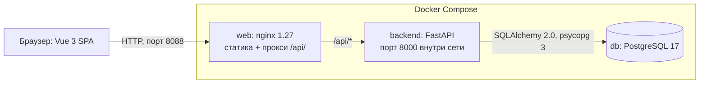
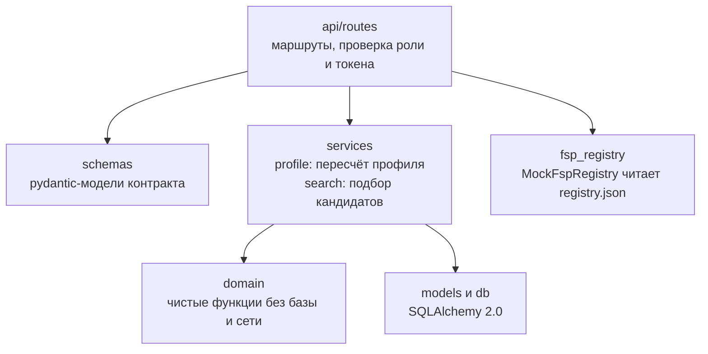
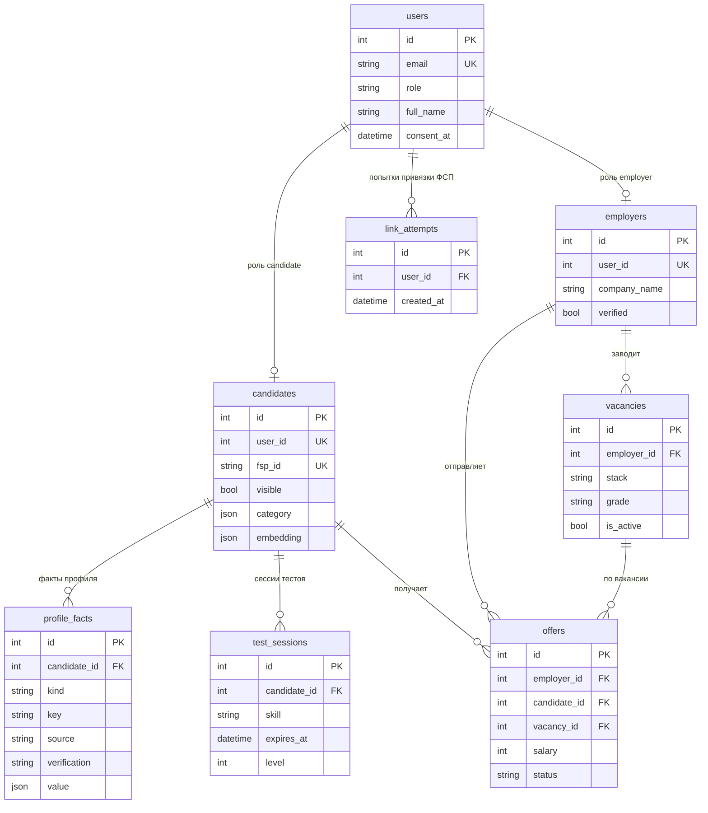

# Архитектура ФСП.Карьера

Краткая техническая документация. Требования — в [SPEC.md](SPEC.md), контракт
API — в [API_CONTRACT.md](API_CONTRACT.md), запуск — в [README](../README.md).
Все числа ниже взяты из спецификации; в коде они собраны в одном файле
`backend/app/domain/scoring_config.py`.

## 1. Компоненты

Три контейнера. Браузер говорит только с `web`: он отдаёт собранный фронтенд и
пробрасывает всё, что начинается с `/api/`, на бэкенд. Никаких внешних сервисов
нет: ни языковой модели, ни внешних эмбеддингов, ни облачных API.



Бэкенд разложен на слои, зависимости идут строго вниз:



Главное правило: пакет `app.domain` не знает ни про базу, ни про HTTP, ни про
настройки. Онтология навыков, разбор резюме, тесты, категоризация, текстовый
вектор и матчинг — обычные функции от данных к данным. Поэтому их тестируют
без базы, а бизнес-правила не размазаны по маршрутам.

Реестр ФСП спрятан за интерфейсом `FspRegistryClient` с единственной
реализацией `MockFspRegistry`. Идея в том, чтобы в рабочей версии подставить
вместо неё клиент настоящего реестра, а остальной код оставить прежним (см.
[FSP_INTEGRATION.md](FSP_INTEGRATION.md)).

## 2. Модель данных

Схема переносимая: тесты идут на SQLite, прод — на PostgreSQL 17. Поэтому нет
`ARRAY`, `JSONB` и расширений, структуры хранятся как `JSON`, ключи целые, а
фильтрация по JSON и сравнение строк делаются в Python, не в SQL.



На диаграмме только ключевые поля, полный список — в SPEC §5. Что важно знать:

- **`profile_facts`** — единственное место, где живёт «что мы знаем о
  человеке». Уникальность `(candidate_id, kind, key, source)`: один и тот же
  навык может прийти из резюме и из теста, это два факта с разными источниками.
  Подпись (`title`) задаёт домен.
- **`candidates.category` и `embedding`** — кэш: результат пересчёта, чтобы
  поиск не пересчитывал профили на каждый запрос. `category = NULL` значит «ещё
  не считали» и трактуется как пустая категория.
- **`candidates.visible`** — работодатель видит только тех, кто явно разрешил
  показ. При регистрации по умолчанию `false`.
- **`offers`**: уникальность `(vacancy_id, candidate_id)`; статус идёт
  `sent → accepted | declined` и дальше не меняется. Контакты в оффер не
  копируются, они вычисляются при чтении по статусу. Срока действия у оффера
  нет.
- **`link_attempts`** нужна только для лимита: не больше 5 попыток привязки
  ФСП в час на пользователя.
- Время хранится как `DateTime(timezone=True)`, в коде везде aware UTC;
  SQLite отдаёт наивные даты, их нормализует помощник `as_utc()`.

После любого изменения фактов или настроек профиля вызывается
`app.services.profile.recompute_candidate(db, candidate)`: он собирает факты,
прогоняет их через домен и записывает свежие `category` и `embedding`.

## 3. Четыре источника профиля

Каждый факт хранит источник и уровень подтверждения; от уровня зависит вес
факта во всех расчётах.

| Источник | Уровень подтверждения | Вес | Откуда берётся |
| --- | --- | --- | --- |
| `fsp`, реестр ФСП | `verified`, «Подтверждено ФСП» | 1.00 | привязка ФСП ID: результаты, разряд, навыки дисциплин, роли |
| `test`, тест платформы | `tested`, «Подтверждено тестом» | 0.85 | экспресс-тест из 6 вопросов: навык с уровнем 1–3 |
| `resume`, резюме | `parsed`, «Из резюме» | 0.55 | разбор правилами: навыки, опыт, формат работы |
| `self`, указано соискателем | `declared`, «Заявлено соискателем» | 0.35 | достижения, добавленные вручную |

Что порождает каждый источник:

- **Реестр ФСП.** Каждый результат — факт `achievement` со ссылкой на протокол;
  старший разряд — факт `rank`; по каждой дисциплине с результатами — навык
  (уровень 3 за призовое место на всероссийском и международном уровне, 2 за
  призовое на региональном и окружном или участие на всероссийском и
  международном, иначе 1); «капитан» и командные роли — факты `role`.
  Привязка идёт по ФИО и дате рождения, см. [FSP_INTEGRATION.md](FSP_INTEGRATION.md).
  Отвязка удаляет все факты этого источника.
- **Тесты.** Четыре теста (Python, JavaScript, SQL, алгоритмы). Сессия — 6
  вопросов, по два каждой из трёх сложностей, лимит 8 минут проверяется на
  сервере. Верные ответы клиенту не отдаются. Набор вопросов и порядок
  вариантов детерминированы от `seed`, который считается как HMAC-SHA256 от
  номера сессии с ключом `JWT_SECRET`. Уровень по сумме весов верных ответов
  (из 12): 12 — «Продвинутый» (3), от 10 — «Уверенный» (2), от 8 — «Базовый»
  (1), иначе «Не сдан» (факт не создаётся). Факт обновляется только вверх.
- **Резюме.** Только правила, `parser = "rules"`. Навыки — по алиасам из
  онтологии (66 навыков), уровень 2 при ИТ-опыте от года, иначе 1; уровня 3 из
  резюме не бывает. Опыт — по диапазонам дат, пересечения склеиваются, периоды
  из разделов про образование и курсы не считаются. Контакты в факты не
  попадают.
- **Вручную.** Олимпиады, хакатоны, CTF: название, год, уровень, результат,
  ссылка на документ. Подпись в интерфейсе: «Не подтверждено. Вклад в грейд —
  35%».

## 4. Алгоритмы

Все они живут в `backend/app/domain/`, это чистые функции.

### 4.1. Свидетельство по навыку

Вес одного факта о навыке: вес подтверждения, умноженный на коэффициент
уровня (уровень 1 — 0.6, 2 — 0.8, 3 — 1.0). «Свидетельство» по навыку `E` —
вес самого сильного факта плюс 0.1 за каждый дополнительный независимый
источник, но не больше 1.

Следствие, заложенное намеренно: резюме даёт максимум `0.55 × 0.8 = 0.44`, а
сданный тест — минимум `0.85 × 0.6 = 0.51`. Тест всегда сильнее резюме.
Пример: Python из резюме с уровнем 2 даёт 0.44; после теста уровня 2 добавляется
факт весом `0.85 × 0.8 = 0.68`, источников два, итого `E = 0.68 + 0.1 = 0.78`.

### 4.2. Стек

Для каждого стека считается сила: сумма свидетельств по его навыкам, где
core-навык стека входит с коэффициентом 1.0, secondary — с 0.5, и не больше 3.
Командная роль из реестра (`backend`, `frontend`, `ml`, `analyst`) добавляет
+0.5 одноимённому стеку, но только если там уже есть хоть какая-то сила.

Основной стек выбирается так:

1. Если сила `backend` и сила `frontend` обе не ниже 1.0, а меньшая не ниже 60%
   большей, это `fullstack`.
2. Иначе побеждает самый сильный из девяти стеков при силе не ниже 0.5 (при
   равенстве — порядок справочника).
3. Иначе стека нет: грейд и роль тоже не определяются, категория
   подписывается «Категория не определена».

Флаг `stack_confirmed` означает, что у основного стека есть core-навык с
фактом `verified` или `tested`.

### 4.3. Грейд

Грейд — это сумма баллов, пересчитанная в ступень, плюс три «гейта», которые
могут опустить ступень ниже, чем говорят одни баллы. Через `y` обозначим ИТ-опыт
в годах (максимум по фактам `experience`).

| Слагаемое | Как считается | Потолок |
| --- | --- | --- |
| Опыт | `k × (12 × min(y, 2) + 9 × max(0, min(y, 8) − 2))`; доверие `k` равно 0.6 без сданных тестов, 0.8 с одним, 1.0 с двумя и более | нет |
| Тесты | за каждый сданный тест: уровень 1 — 5, уровень 2 — 10, уровень 3 — 15 | 30 |
| Результаты ФСП | вес уровня соревнования × коэффициент места | 40 |
| Разряд | берётся старший: III — 3, II — 5, I — 8, КМС — 14, МС — 20 | нет |
| Вручную | вес уровня × коэффициент результата × 0.35 | 10 |

Вес уровня соревнования: муниципальный 2, региональный 5, окружной 8,
всероссийский 14, международный 20. Коэффициент места: первое — 1.0, второе и
третье — 0.8, с четвёртого по десятое — 0.5, дальше — 0.25. Для достижений
вручную коэффициент результата: победа 1.0, призовое место 0.8, участие 0.25.
Баллы за разряды и веса уровней условные и уточняются с ФСП.

Ступени: меньше 6 баллов — `intern`, от 6 до 34.99 — `junior`, от 35 до 69.99 —
`middle`, от 70 — `senior`.

Гейты меняют ступень, но не баллы:

- опыт меньше года — не выше `junior` («Спортивные результаты учтены, но без
  опыта работы грейд не выше Junior»);
- `senior` только при опыте от трёх лет и хотя бы одном факте `verified` или
  `tested`, иначе остаётся `middle`;
- `middle` и выше без единого `verified`/`tested` получает пометку «Грейд
  основан на опыте из резюме без подтверждения. Пройдите тест — опыт будет
  засчитан полнее».

`grade_confirmed` — есть хотя бы один факт `verified` или `tested`.
`grade_explanations` — вклады слагаемых после потолков; их сумма, округлённая
до десятых, всегда равна `grade_points`. Это инвариант, он проверяется тестом.

**Пример расчёта.** Соискатель указал в резюме 5 лет ИТ-опыта и сдал один тест
Python на уровне 2. Реестра ФСП и достижений вручную нет.

- Опыт: `12 × 2 + 9 × (5 − 2) = 24 + 27 = 51`. Сданный тест один, значит
  `k = 0.8`, и вклад `0.8 × 51 = 40.8`.
- Тест: уровень 2 — `10` баллов (потолок 30 не достигнут).
- Результатов ФСП, разряда и достижений вручную нет, это `0`.
- Сумма: `40.8 + 10 = 50.8`, диапазон 35–69.99, то есть `middle`.
- Гейты: опыт больше года, до `senior` далеко, а факт `tested` есть — пометок
  нет, `grade_confirmed = true`.

Без теста тот же человек получил бы `0.6 × 51 = 30.6` и остался бы `junior`.
Тест принёс 10 баллов напрямую и ещё 10.2 через рост доверия к опыту.

Гейт в работе: студент без опыта с двумя победами на международных
соревнованиях набирает `20 + 20 = 40` баллов, что по порогам `middle`. Но
опыта нет, поэтому итог — `junior` с пояснением, а баллы остаются 40.

### 4.4. Роль в команде

1. `lead` — есть факт «тимлид» из строки должности в резюме и ИТ-опыт от трёх
   лет. Источник роли — резюме.
2. `researcher` — баллы ФСП по алгоритмическому программированию не ниже 20 при
   опыте меньше года, либо основной стек `ml`.
3. Иначе по стеку: `devops` → инженер инфраструктуры, `qa` → тестировщик,
   `analyst` → аналитик, остальные → разработчик.

Роль «капитан команды» из реестра в расчёте не участвует, только показывается.

### 4.5. Индекс подтверждённости

От 0 до 100: `50 × [есть хотя бы один результат ФСП] + 25 × min(2, число
сданных тестов)`. Резюме и анкета в индекс не входят: это не подтверждение. Для
работодателя индекс — быстрый ответ на вопрос «насколько этому профилю можно
верить», а чек-лист в кабинете соискателя подсказывает, что сделать, чтобы он
вырос.

### 4.6. Текстовый вектор

Чтобы учесть в поиске свободный текст запроса, профиль и запрос превращаются
в числовые векторы длиной 384 и сравниваются косинусом. Это **лексическое**
сходство, а не семантика: слова и куски слов, без понимания смысла. В
интерфейсе оно так и называется — «Совпадение с текстом запроса».

Текст профиля собирается из навыков (чем сильнее свидетельство, тем чаще
повтор), стека, грейда, роли, названий достижений и дисциплин, «о себе» и
первых 4000 символов резюме; всё сначала проходит `redact_contacts`.
Дальше: нижний регистр, токены, выброшенные стоп-слова русского и английского,
навыки онтологии приведены к id и получают вес ×3. Признаки — слова и
символьные 3-граммы; знаковое хеширование в 384 измерения через `md5`,
логарифмический tf, L2-нормализация. Ни одной внешней библиотеки или сервиса
для этого не требуется.

### 4.7. Матчинг

Сначала жёсткие фильтры. Кандидат должен быть видимым и иметь определённый
стек; дальше по запросу:

- стек (`fullstack` проходит и фильтр `backend`, и фильтр `frontend`), грейд,
  роль — по категории кандидата;
- формат работы — пересечение; кандидат без указанных форматов проходит;
- город — совпал, либо кандидат готов к переезду, либо и в запросе, и у
  кандидата есть удалёнка;
- «только с результатами ФСП», «только подтверждённые» (есть факт `verified`
  или `tested`), дисциплины (есть результат ФСП в одной из них);
- потолок зарплаты — кандидат без ожиданий проходит;
- строгие навыки — у каждого обязательного навыка свидетельство не ниже 0.4.

Затем оценка от 0 до 100:

```
score = 0.45 × skill + 0.25 × text + 0.20 × track_record + 0.10 × confidence
```

- `skill` — насколько закрыты навыки: `0.8 ×` среднее свидетельство по
  обязательным плюс `0.2 ×` среднее по желательным (если нет одной из групп —
  берётся другая).
- `text` — косинус между вектором текста запроса и вектором кандидата, не
  меньше нуля.
- `track_record` — послужной список: половина от ФСП (баллы результатов и
  разряда, делённые на 40, не больше 1) и половина от опыта (баллы опыта,
  делённые на 40, не больше 1).
- `confidence` — индекс подтверждённости, делённый на 100.

Если в запросе нет навыков или нет текста, соответствующий компонент пустой, а
веса остальных пересчитываются так, чтобы сумма осталась единицей. Если нет ни
навыков, ни текста, оценки нет (`score = null`) и интерфейс её не показывает:
выдача сортируется по `track_record`, затем по индексу подтверждённости. В
остальных случаях порядок такой: оценка по убыванию, индекс по убыванию, id по
возрастанию. У каждой строки выдачи есть «почему»: составляющие оценки,
совпавшие и недостающие навыки, главные достижения.

Текст запроса разбирается правилами: найденные навыки добавляются к
желательным, а стек и грейд попадают только в подсказку `parsed_query`, это не
фильтры. Вакансия превращается в запрос так: её стек, грейд и роль становятся
фильтрами, навыки, формат, город и верхняя граница зарплаты переходят как есть,
а текстом служит название плюс описание.

## 5. Приватность до принятого оффера

Работодатель ищет людей, не зная, кто они. Что он видит:

| Данные | До принятого оффера и после отказа | После `accepted` этого работодателя |
| --- | --- | --- |
| Имя | `display_name`, например «Алексей С.» | полное ФИО |
| E-mail, телефон, Telegram | не отдаются | отдаются |
| Дата рождения, текст резюме | не отдаются никогда | не отдаются никогда |
| «О себе», подписи и пояснения фактов (`title`, `evidence`) | отдаются после `redact_contacts` | как есть: контакты этому работодателю уже открыты |
| Комментарий соискателя к офферу | после `redact_contacts` | как есть |

`redact_contacts` заменяет e-mail, телефоны, @ники, ссылки t.me и любые
ссылки на «[скрыто]». Вторая функция, `scrub_personal`, знает, чей это текст,
и убирает из него собственные данные человека: ФИО целиком и по словам, дату
рождения в разных записях, ник без «@», телефон и почту. Поэтому первая строка
резюме вида «Смирнов Алексей Игоревич — разработчик» не раскрывает фамилию в
цитате рядом с навыком. Имя латиницей и инициалы она не распознаёт. Он применяется к тексту, который соискатель мог написать
сам, в том числе когда контакты вписаны в «о себе» или в резюме. Тест
приватности проверяет, что ни в одном ответе работодателю до принятого оффера
нет почты, Telegram, телефона, даты рождения и полного ФИО.

Ещё несколько правил:

- Скрытый и несуществующий кандидат неразличимы: оба дают `404 NOT_FOUND`.
- Смещение (`offset`) в поиске не больше 500, чтобы нельзя было выкачать всю
  базу постраничным обходом.
- Контакты не лежат в оффере: они вычисляются при каждом чтении по статусу.
  Соискатель видит контакты работодателя тоже только после принятия.
- Соискатель видит и меняет только своё, работодатель — только свои вакансии и
  офферы; роль проверяется на каждом защищённом маршруте.
- Пароли хранятся как bcrypt (длина 8–72 байта проверяется в байтах), токен —
  JWT HS256 со сроком жизни `JWT_TTL_MINUTES`.
- Дата рождения и город в записи реестра ФСП — внутренние поля. Дата рождения
  нужна для сверки личности при привязке, и ни одно из двух полей в публичный
  ответ реестра не попадает.

## 6. Формат ошибок

Любой ответ 4xx и 5xx, включая ошибки валидации и отсутствие токена (это 401, а
не 403), имеет один формат:

```json
{
  "success": false,
  "error_code": "FSP_IDENTITY_MISMATCH",
  "message": "Данные не совпали с записью в реестре ФСП",
  "trace_id": "6f1c2a1e-6d0b-4a53-9f43-0d9b5a8e2c11",
  "details": {}
}
```

`error_code` — стабильный код в верхнем регистре, по нему работает фронтенд;
`message` — по-русски, его можно показывать человеку; `trace_id` дублируется в
заголовке `X-Trace-Id`, по нему ищут запись в логах. Ответ 500 тоже в этом
формате, текст исключения наружу не уходит, а CORS-заголовки на месте. Полный
список кодов — в [API_CONTRACT.md](API_CONTRACT.md).

Ошибки целостности базы не превращаются в 500. Гонки решены на уровне базы:
ответ на оффер — `UPDATE … WHERE status = 'sent'`, и если затронуто 0 строк,
это `OFFER_ALREADY_RESPONDED`; двойная отправка оффера и повторная привязка
ФСП ловятся по уникальным ограничениям и дают `OFFER_ALREADY_SENT` и
`FSP_ALREADY_LINKED`.

## 7. Как устроены тесты

- **Домен** (`backend/tests/domain`) — чистые тесты функций без базы: алиасы
  онтологии, разбор резюме, тесты, категоризация, вектор, матчинг. Грейд
  закреплён опорными случаями: 10 лет резюме без тестов — 46.8, `middle`, без
  подтверждения; 5 лет без тестов — 30.6, `junior`; 5 лет и тест уровня 2 —
  50.8, `middle`; 8 лет и два теста уровня 3 — 108, `senior`; студент с двумя
  международными победами — 40, `junior` (гейт); 1 год и тест уровня 3 — 24.6,
  `junior`.
- **API** (`backend/tests/api`) — запросы через `TestClient` к приложению на
  SQLite в памяти (`StaticPool`, `PRAGMA foreign_keys=ON`), схема создаётся из
  метаданных моделей. Фикстуры `candidate_user`, `employer_user`,
  `candidate_headers`, `employer_headers` и фабрика `make_candidate` собирают
  соискателя с нужными фактами. Отдельные наборы: приватность, сквозной
  демо-сценарий после `--reset`, демо-данные.
- **Миграции.** Тест запускает `alembic upgrade head` на временном SQLite-файле
  и сверяет набор таблиц и колонок с метаданными моделей, чтобы миграция и
  модели не разошлись.
- **PostgreSQL.** Автотесты идут на SQLite, а работу на PostgreSQL 17
  проверяет запуск через Docker Compose и демо-сценарий. Переносимые типы
  нужны именно для того, чтобы одна и та же схема работала в обеих базах.
- **Фронтенд.** `npm run typecheck` и `npm run build` (проверка типов плюс
  сборка).

Запуск: `make test`, `make lint`, `make typecheck`, `make build-web`.
